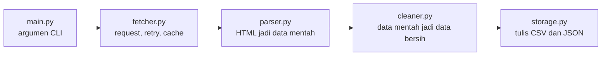

<h1 align="center">🐍 Book Scraper</h1>

<p align="center">
  Web scraper CLI berbasis Python yang mengambil data buku dari <a href="https://books.toscrape.com">books.toscrape.com</a>,<br>
  membersihkannya, lalu menyimpannya ke <b>CSV</b> dan <b>JSON</b>.
</p>

<p align="center">
  
  
  
  
  
</p>

---

## ✨ Fitur

- 📚 Ambil data buku dari beberapa halaman listing **dan** halaman detail tiap buku
- 🔄 Pagination otomatis, berhenti di halaman terakhir
- 🤝 Scraping sopan: User-Agent yang jelas, timeout, jeda antar request
- 🔁 Retry dengan jeda yang makin lama kalau request gagal
- 💾 Cache HTML mentah di `data/raw/`, jadi parsing bisa diulang tanpa request ulang
- 🛡️ Tahan error: satu halaman atau satu buku yang gagal tidak menghentikan program
- 🧹 Data dibersihkan: harga jadi angka, rating jadi 1-5, stok jadi angka
- 📝 Logging (bukan `print`) untuk info dan peringatan
- ✅ Tes dasar dengan pytest, tanpa internet

## 🧰 Teknologi

**Library eksternal** (di `requirements.txt`):

| Library | Nama import | Fungsi |
|---|---|---|
| `requests` | `requests` | Kirim HTTP request ke situs |
| `beautifulsoup4` | `bs4` | Parse HTML jadi pohon yang bisa dicari |
| `pytest` | `pytest` | Jalankan tes |

**Library bawaan Python:** `argparse`, `logging`, `csv`, `json`, `pathlib`, `re`, `time`, `sys`, `urllib.parse`

## 🔀 Alur program



1. **Listing:** ambil tiap halaman daftar buku, ambil judul, harga, rating, stok, dan link detail.
2. **Detail:** buka halaman detail tiap buku untuk mengambil kategori dan jumlah stok.
3. **Cleaning:** ubah teks mentah jadi tipe data yang benar.
4. **Simpan:** tulis hasil ke `books.csv` dan `books.json`.

## 📋 Kolom data

| Kolom | Tipe | Isi |
|---|---|---|
| `title` | string | Judul buku |
| `price` | float | Harga |
| `rating` | int | Rating 1-5 |
| `category` | string | Kategori buku |
| `in_stock` | bool | Tersedia atau tidak |
| `stock_count` | int | Jumlah stok |
| `url` | string | Alamat halaman detail |

## ⚙️ Cara install

1. Clone repo ini dan masuk ke foldernya.
2. Buat dan aktifkan virtual environment:

   ```bash
   python -m venv .venv
   source .venv/bin/activate        # Windows: .venv\Scripts\activate
   ```

3. Install library:

   ```bash
   pip install -r requirements.txt
   ```

## 🚀 Cara pakai

```bash
python main.py --pages 3
```

| Argumen | Fungsi | Default |
|---|---|---|
| `--pages` | Jumlah halaman listing yang di-scrape (20 buku per halaman) | `3` |
| `--delay` | Jeda antar request (detik) | dari `config.py` |
| `--out` | Folder output | `data` |

Contoh lain:

```bash
python main.py --pages 5                    # 5 halaman, 100 buku
python main.py --pages 2 --delay 3          # jeda 3 detik antar request
python main.py --pages 3 --out hasil        # simpan ke folder hasil/
```

Tekan `Ctrl+C` kapan saja untuk menghentikan program dengan tenang.

## 📦 Contoh output

Ringkasan di terminal:

```
2026-10-20 11:30:00,000 [INFO] Start scraping 3 pages
Clean books: 60
Failed: 0
Saved to: data
```

`data/books.csv`:

```csv
title,price,rating,category,in_stock,stock_count,url
A Light in the Attic,51.77,3,Poetry,True,22,https://books.toscrape.com/catalogue/a-light-in-the-attic_1000/index.html
...
```

`data/books.json`:

```json
{
  "title": "A Light in the Attic",
  "price": 51.77,
  "rating": 3,
  "category": "Poetry",
  "in_stock": true,
  "stock_count": 22,
  "url": "https://books.toscrape.com/catalogue/a-light-in-the-attic_1000/index.html"
}
```

## 🧪 Menjalankan tes

```bash
pytest
```

Ada 7 tes (4 untuk `cleaner`, 3 untuk `parser`). Semuanya memakai contoh HTML di `tests/fixtures/`, jadi **tidak butuh internet**.

## 📁 Struktur folder

```
Book-scraper/
├── main.py          # titik masuk CLI, menyambungkan semua bagian
├── fetcher.py       # ambil HTML (request, retry, jeda, cache)
├── parser.py        # ubah HTML jadi data mentah
├── cleaner.py       # rapikan data mentah jadi data bersih
├── storage.py       # tulis CSV dan JSON
├── config.py        # konstanta
├── data/
│   ├── raw/         # cache HTML (tidak di-commit)
│   ├── books.csv
│   └── books.json
├── tests/
│   ├── fixtures/    # contoh HTML untuk tes
│   ├── test_parser.py
│   └── test_cleaner.py
├── requirements.txt
├── pytest.ini
├── SCRAPER.md       # roadmap project
└── README.md
```

## 🎓 Yang dipelajari

HTTP request, parsing HTML, pagination, error handling dan retry, caching, data cleaning, tulis CSV/JSON, `argparse`, `logging`, dan tes dasar dengan pytest.

## 📌 Catatan

Project ini dibuat untuk belajar dan memakai situs latihan. Kalau nanti scrape situs sungguhan: cek `robots.txt` dan syarat penggunaannya dulu, beri jeda antar request, dan jangan ambil data pribadi.

